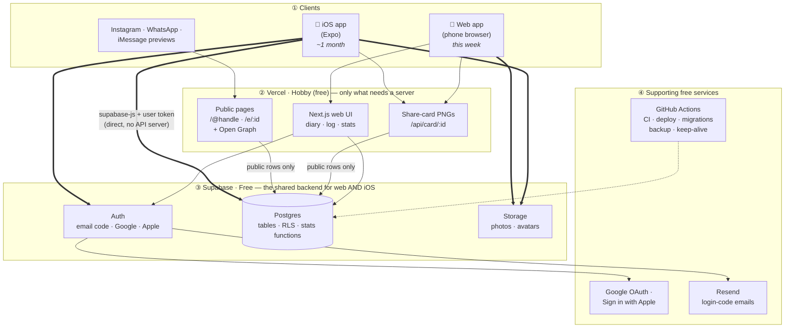
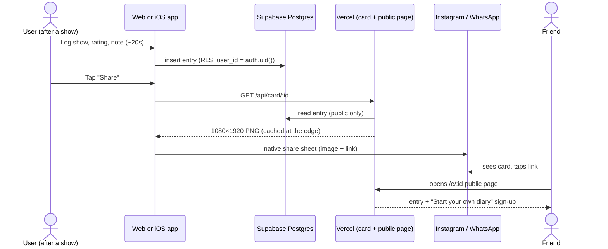

# Architecture

**Status:** Proposed (2026-10-12). Confirm before building; see `docs/DECISIONS.md`.

## Goals

1. **A web version you can use this week** for validation.
2. **An iOS app within about a month** that uses the same accounts and data as the web version.
3. **$0/month running cost** on free tiers until the idea is validated.

## The core idea: the database is the backend

We don't write or host a custom API server. Both clients (web and iOS) talk directly to **Supabase** using the user's login token. **Postgres row-level security (RLS)** decides what each user can read and write. As a result:

- The iOS app gets the same data, accounts and privacy rules for free. Nothing has to be rebuilt for mobile.
- Business rules (rating must be 0.5–5 in half steps, handles are unique, private entries stay private) live **once**, in the database, as constraints, RLS policies and SQL functions. They don't live in two client codebases.
- There's no server to pay for, patch or scale.

The only server code is a few **Next.js routes on Vercel** for work that can't run on a phone or in the database: rendering share-card images, serving public pages with Open Graph tags, and (in Phase 2) calling an LLM with a secret API key.

## Diagram

Rendered copies: [`img/architecture.png`](img/architecture.png), [`img/share-loop.png`](img/share-loop.png). The Mermaid source below is the source of truth.



### The share loop (how a new user arrives)



## Components and their free tiers

Free-tier limits change often. Check the vendor pricing pages before relying on these numbers.

| Component | Service | What it does | Free limit (approx.) |
|---|---|---|---|
| Web hosting + server routes | **Vercel Hobby** | Next.js app, public pages, share-card PNGs | ~100 GB bandwidth/mo, ~1M function calls/mo. **Non-commercial use only.** |
| Database | **Supabase Postgres** | All app data, RLS, stats functions | 500 MB per project, 2 active projects |
| Auth | **Supabase Auth** | Email one-time code, Google, Apple | 50,000 monthly active users |
| File storage | **Supabase Storage** | Entry photos, avatars | 1 GB |
| Login emails | **Resend** (via Supabase custom SMTP) | Sends sign-in codes | ~3,000/mo, 100/day |
| iOS app | **Expo** (EAS Build free tier) | Builds and submits the iOS app | Limited free cloud builds/mo; local builds unlimited |
| Code, CI, cron | **GitHub** + Actions | Repo, lint/test, migrations, backup, keep-alive | Free for public repos; 2,000 min/mo private |
| Domain (optional) | Any registrar, **Cloudflare** DNS | Nicer share links than `*.vercel.app` | ~$10/yr |

**The only unavoidable cost:** the Apple Developer Program (**$99/yr**), needed to ship to the App Store and for Sign in with Apple. You don't need it for the web version.

## Key design choices

### 1. One Supabase project = one source of truth for web and iOS
- The same `auth.users` id identifies a person on web and iOS. Their `profiles` row (handle, display name, default visibility) hangs off that id.
- **Logins:** use email one-time codes (no passwords to manage) plus Google this week, and add **Sign in with Apple** before iOS ships. Apple's App Store rule 4.8 requires it if the app offers Google login.
- Supabase automatically links logins that share the same verified email. One exception: Apple's "Hide my email" relay address creates a separate account. Plan a "link accounts" option in settings later.

### 2. Rules live in Postgres
- `CHECK` constraints: rating is `NULL` or in `{0.5, 1.0 … 5.0}`; the handle matches `^[a-z0-9_]{3,20}$` and is unique case-insensitively.
- **RLS policies:**
  - The owner can do anything with their own rows.
  - Anyone (including logged-out visitors) can `SELECT` entries where `visibility = 'public'` and the owner's profile is public.
  - Shows and venues are readable by everyone; any logged-in user can insert them, and only the creator can edit their own unverified rows.
- **Stats** are a SQL function (e.g. `user_stats(user_id)`) that respects visibility, so web, iOS and the public profile all show identical numbers.
- Types are generated with `supabase gen types typescript` and shared by both apps.

### 3. Vercel holds only what needs a server
- `/api/card/[id]`: renders the Instagram Story card (1080×1920) with `next/og`, reading data through the **anon key**, which means RLS lets it see public entries only. Responses are cached at the edge, so crawlers and repeat shares don't re-render.
- `/@[handle]` and `/e/[id]`: server-rendered public pages with `og:image` pointing at the card route.
- The Supabase **service-role key is never deployed** in this phase, so a bug in a route can't bypass RLS.
- Phase 2 adds `/api/import/email`, which calls an LLM with a server-side key. That's the first paid usage, and only a few pence.

### 4. Photos
- Resize to roughly 1600px and **re-encode on the device before upload**: canvas on web, `expo-image-manipulator` on iOS. Re-encoding drops EXIF/GPS, and the free tier has no server-side image processing.
- This keeps photos around 200–300 KB, so 1 GB of storage holds about 4,000 photos. **Storage is likely the first free-tier limit you'll hit.**
- Phase 2 photo import reads EXIF **on the device** before stripping it. Only the extracted date and venue match are kept.

### 5. iOS: Expo (React Native) over native Swift *(recommended, needs your call)*
- **Pros:** it's TypeScript like the web app, so the generated DB types, validation (e.g. zod schemas), rating and date helpers and Supabase queries live in one shared package. Android comes almost free later. A solo builder can ship it in weeks.
- **Cons:** it feels slightly less native than SwiftUI. Some iOS-only features (widgets, Live Activities) need native modules.
- **If you'd rather write Swift:** the backend design doesn't change at all. Use `supabase-swift` against the same project. You'd just lose shared TypeScript code.

### 6. Repo layout (monorepo from day one, so iOS slots in without a reshuffle)

```
stubb/
├── apps/
│   ├── web/            # Next.js (this week)
│   └── ios/            # Expo app (next month)
├── packages/
│   └── shared/         # DB types, zod schemas, rating/date/stats helpers
├── supabase/
│   ├── migrations/     # SQL: tables, constraints, RLS, functions
│   ├── seed.sql        # London / NYC / Edinburgh venues + starter shows
│   └── tests/          # RLS/privacy tests (pgTAP)
└── docs/
```

pnpm workspaces only. No Turborepo or Nx until the build gets slow enough to need one.

### 7. Environments
| Environment | Database | Web |
|---|---|---|
| Local | `supabase start` (Docker, free, unlimited) | `pnpm dev` |
| Preview | Supabase project #2 ("staging") | Vercel preview deploys per PR |
| Production | Supabase project #1 | Vercel production (`main`) |

This uses both free Supabase project slots. Supabase's own branching feature is paid, so we skip it.

## Free-tier risks and mitigations

| Risk | Mitigation |
|---|---|
| Supabase pauses free projects after **7 days idle** | GitHub Actions cron sends a tiny query every few days. During validation, real use keeps it awake anyway. |
| **No automatic backups** on the Supabase free plan | Nightly GitHub Action: `pg_dump` → encrypt (`age`) → upload as an Actions artifact (90-day retention). Encryption matters if the repo is public. |
| Supabase's built-in email sender is heavily rate-limited | Configure Resend as custom SMTP from day one. |
| Vercel Hobby is **non-commercial only** and pauses (doesn't bill) at limits | Fine while monetisation is deferred. Move to Pro ($20/mo) or Cloudflare Pages if that changes. |
| Storage fills up (1 GB) | Resize on device (above). Monitor; Supabase Pro is $25/mo when needed. |
| Share links are tied to a `*.vercel.app` domain | Buy a domain early (~$10/yr) so links shared on Instagram keep working if hosting ever moves. |

**Upgrade trigger:** when the free tiers bind, you've validated the idea. Supabase Pro ($25/mo) is the first upgrade. It removes pausing and adds daily backups.

## This week's web slice (validation build)

The smallest version that tests the two signals that matter (do people log, do people share):

1. Sign in (email code + Google) and claim a handle
2. Log an entry: search the seeded shows or add one, pick a venue, date, half-star rating, optional note
3. Diary: reverse-chronological list, edit and delete
4. Share card PNG + public entry page with Open Graph preview
5. Basic stats header (shows this year, venues, average rating)

Deferred to the following weeks: photos, trips/tags, the full stats page, public profile, CSV export.
