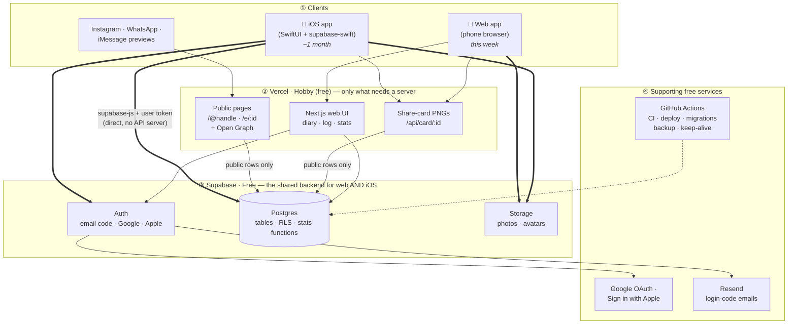
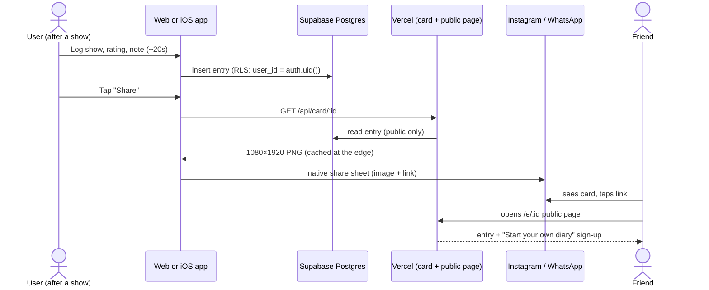

# Architecture

**Status:** Proposed (2026-10-12). Confirm before building; see `docs/DECISIONS.md`.

## Goals

1. **A web version you can use this week** for validation.
2. **An iOS app within about a month** that uses the same accounts and data as the web version.
3. **$0/month running cost** on free tiers until the idea is validated.

## The core idea: the database is the backend

We don't write or host a custom API server. Both clients (web and iOS) talk directly to **Supabase** using the user's login token. **Postgres row-level security (RLS)** decides what each user can read and write. As a result:

- The iOS app gets the same data, accounts and privacy rules for free. Nothing has to be rebuilt for mobile.
- Business rules (rating must be 0.5–5 in half steps, handles are unique, private entries stay private) live **once**, in the database, as constraints, RLS policies and SQL functions. They don't live in two client codebases.
- There's no server to pay for, patch or scale.

The only server code is a few **Next.js routes on Vercel** for work that can't run on a phone or in the database: rendering share-card images, serving public pages with Open Graph tags, and (in Phase 2) calling an LLM with a secret API key.

## Diagram

Rendered copies: [`img/architecture.png`](img/architecture.png), [`img/share-loop.png`](img/share-loop.png). The Mermaid source below is the source of truth.



### The share loop (how a new user arrives)



## Components and their free tiers

Free-tier limits change often. Check the vendor pricing pages before relying on these numbers.

| Component | Service | What it does | Free limit (approx.) |
|---|---|---|---|
| Web hosting + server routes | **Vercel Hobby** | Next.js app, public pages, share-card PNGs | ~100 GB bandwidth/mo, ~1M function calls/mo. **Non-commercial use only.** |
| Database | **Supabase Postgres** | All app data, RLS, stats functions | 500 MB per project, 2 active projects |
| Auth | **Supabase Auth** | Email one-time code, Google, Apple | 50,000 monthly active users |
| File storage | **Supabase Storage** | Entry photos, avatars | 1 GB |
| Login emails | **Resend** (via Supabase custom SMTP) | Sends sign-in codes | ~3,000/mo, 100/day |
| iOS app | **Xcode** + TestFlight | Build locally, beta-test via TestFlight | Free with the Apple Developer Program. Xcode Cloud includes some free build hours/mo if CI is wanted. Avoid macOS GitHub runners on a private repo: they burn free minutes at 10×. |
| Code, CI, cron | **GitHub** + Actions | Repo, lint/test, migrations, backup, keep-alive | Free for public repos; 2,000 min/mo private |
| Domain (optional) | Any registrar, **Cloudflare** DNS | Nicer share links than `*.vercel.app` | ~$10/yr |

**The only unavoidable cost:** the Apple Developer Program (**$99/yr**), needed to ship to the App Store and for Sign in with Apple. You don't need it for the web version.

## Key design choices

### 1. One Supabase project = one source of truth for web and iOS
- The same `auth.users` id identifies a person on web and iOS. Their `profiles` row (handle, display name, default visibility) hangs off that id.
- **Logins:** use email one-time codes (no passwords to manage) plus Google this week, and add **Sign in with Apple** before iOS ships. Apple's App Store rule 4.8 requires it if the app offers Google login.
- Supabase automatically links logins that share the same verified email. One exception: Apple's "Hide my email" relay address creates a separate account. Plan a "link accounts" option in settings later.

### 2. Rules live in Postgres
- `CHECK` constraints: rating is `NULL` or in `{0.5, 1.0 … 5.0}`; the handle matches `^[a-z0-9_]{3,20}$` and is unique case-insensitively.
- **RLS policies:**
  - The owner can do anything with their own rows.
  - Anyone (including logged-out visitors) can `SELECT` entries where `visibility = 'public'`. **New entries default to public** (from `profiles.default_visibility`, which defaults to `'public'`); the log form shows the current setting and toggles per entry.
  - Shows and venues are readable by everyone; any logged-in user can insert them, and only the creator can edit their own unverified rows.
- **Stats** are a SQL function (e.g. `user_stats(user_id)`) that respects visibility, so web, iOS and the public profile all show identical numbers.
- Types are generated from the schema for each app: `supabase gen types --lang typescript` for web, `--lang swift` for iOS. The **schema is the contract** between the two codebases.

### 3. Vercel holds only what needs a server
- `/api/card/[id]`: renders the Instagram Story card (1080×1920) with `next/og`, reading data through the **publishable (anon) key**, which means RLS lets it see public entries only. Responses are cached at the edge, so crawlers and repeat shares don't re-render.
- `/@[handle]` and `/e/[id]`: server-rendered public pages with `og:image` pointing at the card route.
- The Supabase **service-role key is never deployed** in this phase, so a bug in a route can't bypass RLS.
- Phase 2 adds `/api/import/email`, which calls an LLM with a server-side key. That's the first paid usage, and only a few pence.

### 4. Photos
- Resize to roughly 1600px and **re-encode on the device before upload**: canvas on web, `ImageIO`/`UIImage` JPEG re-encode on iOS. Re-encoding drops EXIF/GPS, and the free tier has no server-side image processing.
- This keeps photos around 200–300 KB, so 1 GB of storage holds about 4,000 photos. **Storage is likely the first free-tier limit you'll hit.**
- Phase 2 photo import reads EXIF **on the device** before stripping it. Only the extracted date and venue match are kept.

### 5. iOS: native SwiftUI *(decided 2026-10-12)*
- SwiftUI app using [`supabase-swift`](https://github.com/supabase/supabase-swift) against the **same** Supabase project as the web app: same users, same data, same RLS.
- No code is shared with the web app, so **logic shared by both apps belongs in Postgres**, not in either client:
  - validation lives in `CHECK` constraints;
  - stats live in SQL functions (`user_stats`, etc.);
  - search lives in a SQL function (e.g. `search_shows(q)` using `pg_trgm`).
  Each client only renders and calls these. That stops the Swift and TypeScript versions drifting apart.
- Sign in with Apple is native (`AuthenticationServices`) → `supabase.auth.signInWithIdToken`. Google uses the GoogleSignIn SDK the same way.
- Sharing: the app fetches the same `/api/card/:id` PNG from Vercel and opens `ShareLink` / the share sheet. That gives one card design, not two.
- Universal links: `/.well-known/apple-app-site-association` served by Next.js, so `/e/:id` links open in the app when it's installed.

### 6. Repo layout: one monorepo

```
stubb/
├── apps/
│   ├── web/            # Next.js: landing page (/), owner app (/app), share cards. Vercel root directory.
│   └── ios/            # SwiftUI Xcode project (next month)
├── supabase/
│   ├── migrations/     # SQL: tables, constraints, RLS, functions (the shared "API")
│   ├── seed.sql        # US / UK venues + starter shows
│   └── tests/          # RLS/privacy tests (pgTAP)
├── packages/           # shared JS packages, only if ever needed
└── docs/
```

- **One repo**, so a schema change and both clients' updates can land in the same PR.
- **pnpm workspaces** (no Turborepo/Nx). Root scripts proxy to `apps/web`: `pnpm dev`, `pnpm lint`, `pnpm typecheck`, `pnpm build`.
- **The landing page lives inside the web app**, not in a separate app. It gets the same domain, fonts and design tokens, and the landing mockups can use the real share-card route. The waitlist is a Server Action next to it. It can be split out later if it ever needs to be.

### 7. Environments
| Environment | Database | Web |
|---|---|---|
| Local | `supabase start` (Docker, free, unlimited) | `pnpm dev` (root); iOS Simulator against local Supabase |
| Preview | Supabase project #2 ("staging") | Vercel preview deploys per PR |
| Production | Supabase project #1 | Vercel production (`main`) |

This uses both free Supabase project slots. Supabase's own branching feature is paid, so we skip it.

## Free-tier risks and mitigations

| Risk | Mitigation |
|---|---|
| Supabase pauses free projects after **7 days idle** | GitHub Actions cron sends a tiny query every few days. During validation, real use keeps it awake anyway. |
| **No automatic backups** on the Supabase free plan | Nightly GitHub Action: `pg_dump` → encrypt (`age`) → upload as an Actions artifact (90-day retention). Encryption matters if the repo is public. |
| Supabase's built-in email sender is heavily rate-limited | Configure Resend as custom SMTP from day one. |
| Vercel Hobby is **non-commercial only** and pauses (doesn't bill) at limits | Fine while monetisation is deferred. Move to Pro ($20/mo) or Cloudflare Pages if that changes. |
| Storage fills up (1 GB) | Resize on device (above). Monitor; Supabase Pro is $25/mo when needed. |
| Share links are tied to a `*.vercel.app` domain | Buy a domain early (~$10/yr) so links shared on Instagram keep working if hosting ever moves. |

**Upgrade trigger:** when the free tiers bind, you've validated the idea. Supabase Pro ($25/mo) is the first upgrade. It removes pausing and adds daily backups.

## This week: "NYC week" (owner-only build + public landing page)

Tracked in the **NYC week** epic on GitHub (label `nyc-week`). Goal: the owner logs their NYC trip and posts an excellent share at the end of the week, while a public landing page collects waitlist emails.

| Surface | Who | What |
|---|---|---|
| `/` landing page | Public | Hero, phone mockups of real share cards, features, waitlist form |
| `/login` (unlinked, `noindex`) | Owner only | Email one-time code; **public sign-ups disabled** in Supabase Auth |
| `/app/*` | Owner only | Log entry, trips/labels, import from email or photo, diary |
| `/api/card/*`, `/e/:id`, `/t/:id` | Public | Entry and trip share cards + public pages with Open Graph |

Additions to the architecture for this week:
- **Waitlist → Kit.** The landing form subscribes visitors to a Kit form with double opt-in (confirmation email); a honeypot field blocks simple bots. The `waitlist` table (anon insert-only, RLS) remains as the fallback when Kit isn't configured. See `docs/DECISIONS.md`.
- **Smart import route** `/api/import` (Vercel, server-side key). It takes pasted email text or a downscaled photo plus EXIF hints, and a small Claude model returns structured drafts. Drafts are only saved after the owner confirms them. **This is the first paid usage** (fractions of a penny per import) and needs the owner's OK and an API key.
- **Photos** read EXIF (date, GPS) on the device for matching, then are re-encoded without metadata before upload.

Deferred until after NYC week: public sign-up, Google/Apple login, handles chosen by other users, the stats page, public profile, CSV export.
